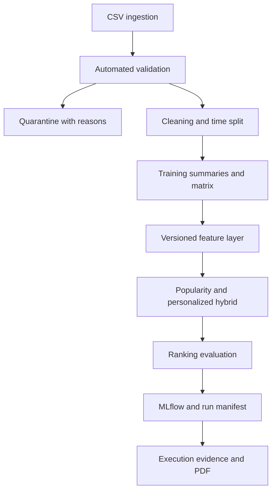

# Recommendation pipeline

DM4ML Assignment 2: modular movie recommendation with a reproducible chronological data pipeline.

**Submission status:** included execution results and report preview were generated in the ChatGPT execution environment, **not BITS Lab**. They are reference outputs. Run this project in BITS Lab, review and understand the code, add your own student details and GitHub repository URL, and regenerate the evidence/report before submitting. No repository has been published on your behalf. Follow your course rules on assistance and attribution.

## Quick start on BITS Lab

Requires Linux/macOS, Python **3.12** (tested), pip and venv. No Docker, GPU, database, account credentials or dataset download is needed. Installation needs internet access to Python packages. Run from the repository root.

```bash
python3.12 -m venv .venv
source .venv/bin/activate
python -m pip install -r requirements.txt
python -m dags.workflow --environment "BITS Lab"
RUN=$(cat runs/LATEST)
python -m unittest discover -s tests -v
python -m src.predict --run "$RUN" --user 1
```

Every execution creates a unique directory in `runs/`; `runs/LATEST` changes only after success. A failed workflow returns nonzero, records the failure and does not update LATEST. It does not resume old tasks: rerunning starts a clean run. Record the new run directory printed by the command; do not accidentally use old evidence after a failure.

## Generate execution screenshots and PDF

The safest evidence is a screenshot of each stage in the actual lab terminal plus the successful workflow summary. Names expected by the PDF builder: `ingestion.png`, `validation.png`, `preparation.png`, `transformation.png`, `feature_management.png`, `model_training.png`, `model_evaluation.png`, `orchestration.png`. Make sure every image is readable and includes environment/run context. For manually captured images, add `--screenshots /absolute/path/to/screenshots` to the builder command.

The included preview uses genuine terminal screenshots displaying saved local stage logs. The browser capture helper could not be exercised in this environment because browser processes were restricted; use lab terminal screenshots if it is unavailable there.

Alternatively, the helper captures browser screenshots of a viewer containing verbatim saved execution logs. They are **log-viewer screenshots, not terminal captures**. Run it in the lab after execution. Confirm your evaluator accepts this presentation of execution logs; otherwise use terminal screenshots.

```bash
python -m pip install -r requirements-evidence.txt
python -m playwright install chromium
# On a fresh lab Linux image, an administrator may also need:
# python -m playwright install-deps chromium
RUN=$(cat runs/LATEST)
python tools/capture_evidence.py --run "$RUN"
python tools/build_report.py --run "$RUN" --out submission/preview.pdf
```

To build the final submission PDF, supply your **real** repository and details:

```bash
python tools/build_report.py --run "$RUN" \
  --repo-url https://github.com/YOUR_ACCOUNT/recommendation-pipeline \
  --student "YOUR NAME | YOUR STUDENT ID" \
  --confirm-lab-run --final \
  --out submission/Recommendation_Pipeline_Final.pdf
```

The URL above is an example to replace, not an existing repository. `--confirm-lab-run` is your attestation, not automatic verification of infrastructure. Final mode requires it, a BITS-labelled run and student details. The PDF has a 3-page design/results report plus a 4-page evidence appendix. Do not submit the local preview with its pending URL. The builder checks screenshot hashes for automatically captured evidence. Manual screenshots are your responsibility to match to the selected run.

## Architecture



A static diagram is supplied in `diagrams/architecture.svg`. `dags/workflow.py` defines explicit task dependencies, failure handling, run provenance and orchestration. `dags/schedule.cron` gives an optional daily schedule with a lock. Replace the absolute paths before installing it with `crontab -e`. The assignment explicitly permits a clearly structured scheduled Python workflow; no Airflow service is required.

## Project layout

```text
configs/pipeline.json       Seed, time window, threshold, K and fixed weights
src/ingestion/              Deterministic synthetic source or CSV ingestion
src/validation/             Schema, type, range, duplicate and FK checks
src/preparation/            Metadata cleaning and global temporal split
src/transformation/         Training summaries and sparse rating matrix
src/features/               Checksum-verified custom feature layer
src/training/               Fit, serialize, load and recommend
src/evaluation/             Ranking metrics, cohort accounting and CSV results
src/predict.py              Inference and unknown-user fallback
dags/                      Dependency workflow and cron example
tools/                     Evidence capture and PDF creation
tests/                     Data contracts and executed-pipeline integration checks
diagrams/                  Static architecture diagram
reference_run/             Completed local reference execution and terminal log screenshots
submission/                Local preview PDF and final report instructions
runs/<run-id>/             New raw/processed/features/errors, models and reports
```

## Dataset and assumptions

The default is **clearly documented synthetic data**, which the brief allows. With seed 42, NumPy generates 200 fictional users, 120 fictional movies and 42 distinct movie interactions per user (8,400 valid ratings). Movie genres cycle through six categories. Each user's latent category preference is sampled from a Dirichlet distribution. Items are sampled without replacement with probability 25% uniform plus 75% category preference. Ratings are rounded, clipped to 1-5 and influenced by the relative category preference plus Gaussian noise. Uniform timestamps span 2025-01-01 to 2025-07-01 UTC (exclusive end).

Eight invalid rows and two exact duplicates are appended deliberately. They demonstrate unknown users/items, malformed IDs, missing or nonnumeric ratings, ratings outside 1-5, invalid timestamps and future timestamps. One optional user age and one optional item category are missing for preparation. No real people, movies or user behavior are represented. The generator's affinity structure makes the hybrid's task easier than many real-world datasets; do not generalize the reported metrics.

Raw tables:

| Table | Columns | Contract |
|---|---|---|
| users.csv | user_id, age, region | Positive integer unique ID; optional age/region |
| items.csv | item_id, title, category | Positive integer unique ID and nonempty title; optional category |
| interactions.csv | user_id, item_id, rating, timestamp | Existing IDs, numeric rating 1-5, UTC-convertible timestamp in configured window |

For your own data use `python -m dags.workflow --source /path/to/csvs --environment "BITS Lab"`. It must follow these schemas; change start/cutoff/end in a copied config and pass `--config path.json`. IDs must be positive integers, ratings explicit 1-5 values. Static metadata is assumed available at cutoff. This adapter is not a one-click MovieLens importer.

## Validation and preparation

Required columns must exist; optional-valued columns may contain missing data but must be present. Invalid records go to `data/errors/<table>.csv` with CSV line number and semicolon-separated reasons. Reason counts overlap when a row violates several checks. Invalid parent keys are removed before child foreign-key checks. `reports/validation.json` records accepted/rejected counts and repairable missing values.

Missing ages are median-filled from static users (unused by models), strings are stripped, missing categories/regions become Unknown, timestamps normalize to UTC. Training uses events **before** 2025-05-01; test uses events **at or after** that instant. Repeated user-item updates retain the latest on each side separately. Test ratings do not overwrite training events. Seen training pairs are excluded from evaluation positives and recommendation candidates. The workflow asserts strict time ordering and nonempty partitions.

## Features and leakage control

`data/features/metadata.json` records v1, as-of cutoff and feature-file hashes. `FeatureStore` verifies hashes before loading. `reports/feature_catalog.csv` and `.md` document eleven features with entity, type, definition and source. Features include user count/mean/recency/category preference, item count/mean/positive count/category, and interaction positive/recency fields. Summary features are available for analysis; the ranker consumes the positive indicator, item positive count, category and category preference. Prediction validates and reuses the saved snapshot and model artifacts. This is a small batch feature layer, not an online feature service.

All behavioral aggregates and similarities use **only training data**; the static item catalog supplies category metadata. Smoothed user-category preference is `(positive count in category + 1)/(total user positives + number of categories)`. The matrix and its row/column mappings are saved as sparse NPZ plus JSON. Models save a dense 120x120 similarity matrix; this implementation is for small catalogs.

## Models and experiment tracking

1. **Popularity:** descending count of ratings >= 4 in training, with item-ID tie breaks.
2. **Personalized hybrid:** binary-positive item cosine collaborative score (self-similarity zeroed), plus smoothed category preference and popularity. CF and category components normalize by the user's maximum; popularity normalizes by global maximum. Weights 0.65/0.30/0.05 are fixed before evaluation.

Both filter seen training items. Unknown users get the popularity fallback. Models rank items; they **do not predict explicit ratings**, so RMSE/MAE are not applicable. Fitted matrices and parameters use safe non-pickle NPZ and JSON.

MLflow logs one finished experiment run per model, with parameters, the five metrics, model files, feature files and reports. File-based MLflow tracking is at `<run>/mlruns`; the lightweight distribution avoids server dependencies. `run.json` records MLflow IDs and all artifact hashes. To inspect runs without a UI:

```bash
python - "$RUN" <<'PYCODE'
import sys
from pathlib import Path
from mlflow.tracking import MlflowClient
client = MlflowClient(tracking_uri=(Path(sys.argv[1]).resolve()/"mlruns").as_uri())
for experiment in client.search_experiments():
    for run in client.search_runs([experiment.experiment_id]):
        print(run.info.run_name, run.info.status, run.data.metrics)
PYCODE
```

For a UI you may install full `mlflow==3.5.1` separately and run `mlflow ui --backend-store-uri "file://$RUN/mlruns" --host 127.0.0.1 --port 5000`. This is optional, not required for the default workflow. MLflow file stores embed absolute artifact URIs: copied reference runs are archival examples. Generate a fresh lab run for correct local artifact links.

## Evaluation protocol

K=5. Relevance is held-out rating >=4. Candidates are all training-known items minus that user's seen training items. Metrics average across users with at least one relevant, unseen, train-catalog test item. Cold users and users without eligible positives are excluded and counted in `evaluation_protocol.json`. Cold items and repeated training-seen positive pairs are counted as unrecommendable. No negative sampling and no test-set tuning are used.

| Metric | Definition |
|---|---|
| Precision@5 | Relevant recommendations / 5 |
| Recall@5 | Relevant recommendations / eligible positive test items |
| NDCG@5 | Binary DCG with log2(rank+1) discount / ideal DCG |
| Coverage | Distinct recommended items / training catalog size |
| Diversity | Mean fraction of recommendation pairs with different categories |

If fewer than K candidates exist, precision still divides by K and diversity is 0 for fewer than two recommendations. All observed categories, including Unknown, are distinct for diversity.

## Local reference results

The included local run accepted 8,400 of 8,410 interactions and quarantined 10. Training contains 5,543 rows; test contains 2,857. All 200 users are eligible. Results:

| Model | Precision@5 | Recall@5 | NDCG@5 | Coverage | Diversity |
|---|---:|---:|---:|---:|---:|
| Popularity | 0.1070 | 0.0658 | 0.1020 | 0.1250 | 0.5425 |
| Personalized hybrid | 0.4270 | 0.2897 | 0.4345 | 0.9250 | 0.0770 |

The hybrid improves ranking metrics and catalog coverage here but concentrates each user's list into one category. Report that limitation; do not claim it improves every metric. Synthetic bias, a single split, training-only catalog evaluation and quadratic similarity storage limit generality. Next steps: a real dataset, earlier validation window, diversity-aware reranking, sparse nearest neighbors and cold-start evaluation.

## GitHub publication and hand-in

Create an empty GitHub repository under your own account. Do not upload `.venv/`, credentials or machine-local `runs/` paths. The included `reference_run/` is synthetic and safe to inspect, but label it as a local reference. Add **your lab evidence and results** before pushing:

```bash
mkdir -p lab_evidence
cp -R "$RUN/logs" "$RUN/reports" "$RUN/evidence" lab_evidence/
cp "$RUN/run.json" "$RUN/config.json" lab_evidence/
git init
git add .
git commit -m "Implement reproducible recommendation data pipeline"
git branch -M main
git remote add origin https://github.com/YOUR_ACCOUNT/recommendation-pipeline.git
git push -u origin main
```

Replace the URL, and authenticate through your own GitHub tooling. If your folder is already a git repository, reuse its remote and omit init/remote-add as appropriate. The screenshots copy assumes automatic capture was used; copy your manual screenshot directory instead if needed. Rebuild the final PDF after the actual URL is known. Open the resulting PDF and repository in a browser before submission; include the PDF and repository link as instructed. For a private repo ensure the evaluator has access. The report builder cannot check remote accessibility or lab identity.
